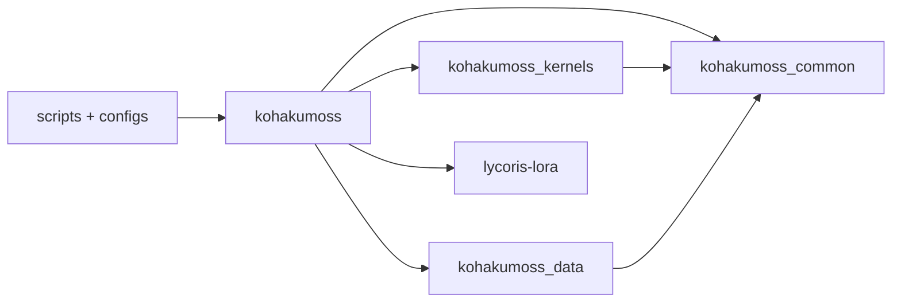
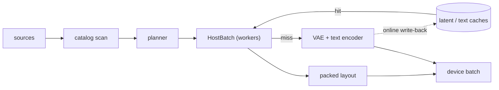
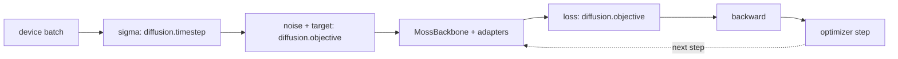
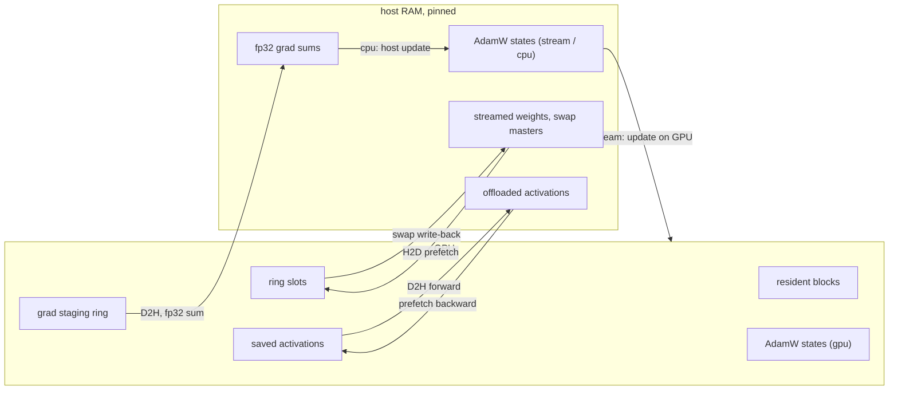
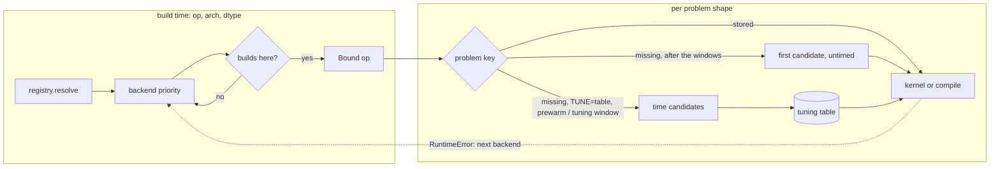
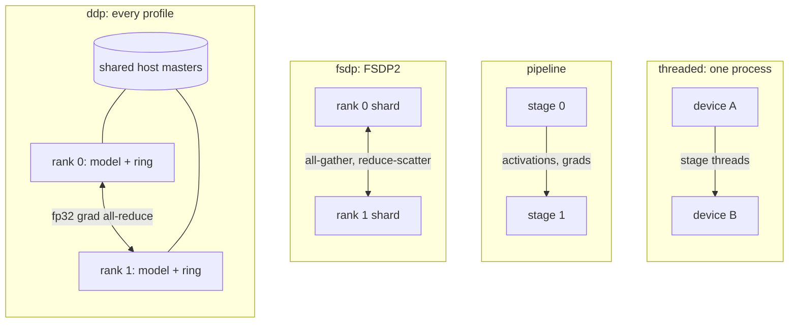

简体中文 | [English](README.en.md)

<a id="kohakumoss"></a>
# KohakuMoss

一个 [MOSS-Image](https://huggingface.co/OpenMOSS-Team/MOSS-Image-Base)
（MOSS-Image-Base / -SFT）微调框架：支持全部 LyCORIS 算法，以及在原生分辨率下对文本-图像数据
进行全量微调，并提供推理；可在 Windows 和 Linux 上运行，从 6 GB 显卡到多 GPU 节点。


一个风格 LoRA（rank 8、fp16、fp8 基础 GEMM），在单张 RTX 4090 上以约 batch 4（每步 20k
词元）训练 100 步，使用激进的 `ckpt-ring4-actoff` 卸载配置档，并在每一步在线运行文本编码器
与 VAE 编码：显卡占用 12-13 GB，约 0.85 张图/秒。上排为 MOSS-Image-Base，下排为 LoRA；
采样器 32 步，CFG 3，每列使用相同种子。

- **适配器与全量微调。** 通过 [LyCORIS](https://github.com/KohakuBlueleaf/LyCORIS) 支持
  LoRA / LoCon、LoHa、LoKr、DoRA、OFT、BOFT、GLoRA、IA3、DyLoRA、T-LoRA（沿用其算法、
  保存格式与融合内核），并支持 dropout、LoRA+、bypass 或合并前向以及目标层预设；全量微调
  按 MOSS 技术报告使用 Muon + AdamW 和 EMA。
- **自有 MOSS-Image 实现**，面向打包的变长批次（单一扁平词元轴，注意力保持在每个样本内部），
  并与官方代码对照验证：fp32 前向相对误差 4.7e-6，50 步采样 LPIPS 2.3e-6。
- **按 GPU 架构选择内核。** sm70 / sm75 使用 TileLang，sm80+ 和 Intel Arc 使用 Triton；
  包含变长注意力、块运算和融合线性层。每个算子在每种架构、dtype 和形状下，绑定到其内核与
  `torch.compile` 中更快的一方，每张卡测量一次并存入调优表。
- **精度。** bf16，以及为不支持 bf16 的显卡提供 fp16（带 fp16 残差修复）；训练和推理中
  DiT 与文本编码器支持 fp8 和 MXFP8 计算（sm89+）；冻结的基础权重支持 int8 / fp8
  仅权重量化。
- **显存配置档**，从 `speed` 到 `minimal`，包含 240 项目录，或手动调节各项参数：
  梯度检查点、权重流式传输、激活卸载、梯度卸载、主机优化器状态。适配器训练可装入 8 GB
  和 6 GB 显卡；全量微调可在单张 24 GB 显卡上配合主机 master 权重运行。
- **原生分辨率数据。** 支持 kohya / folder / jsonl / parquet / webdataset / native
  shard 数据源，带缓存的增量目录，resize / bucket / crop 规划器，按词元分批，离线与在线
  latent / 文本缓存；规划是数据、种子和参数的纯函数，因此恢复运行时会精确重放。
- **多 GPU（Linux）。** 每种显存配置档下都支持 DDP（包括权重流式传输）、FSDP2、流水线和
  线程化流水线。
- **导出。** LyCORIS 文件、ComfyUI 格式适配器（采用 ComfyUI 的 MOSS-Image 模型键布局，
  并包含其融合 q/k/v 重打包）、合并后的 transformer 和 diffusers transformer。
- **配置。** 每个脚本都是 [KohakuEngine](https://github.com/KohakuBlueleaf/KohakuEngine)
  （`kogine`）脚本：设置是模块级参数，配置由预设层组合而成，`kohakumoss-config` 会为你的
  GPU 和数据集写出经过检查的配置。

<a id="install"></a>
## 安装

torch 来自与你的 GPU 和驱动匹配的 PyTorch 索引；安装助手会检测两者，从该索引安装 torch，
再安装带默认 extra 的 KohakuMoss，最后运行 `kohakumoss-doctor`，列出所有缺失项及修复命令。
要求：Python 3.10+（助手会创建 3.12 虚拟环境）、CUDA 12.6+ 的 NVIDIA 驱动或 Intel Arc
驱动；Windows 上需要 Visual Studio Build Tools（“使用 C++ 的桌面开发”）；sm70 / sm75
需要 CUDA toolkit（`nvcc`）。

Windows（PowerShell）：

```powershell
git clone https://github.com/KohakuBlueleaf/KohakuMossTrainer; cd KohakuMossTrainer
powershell -ExecutionPolicy Bypass -File scripts\install\install.ps1
Set-ExecutionPolicy -Scope CurrentUser RemoteSigned   # once per user, so Activate.ps1 may run
.venv\Scripts\Activate.ps1                            # in cmd: .venv\Scripts\activate.bat
```

Linux：

```bash
git clone https://github.com/KohakuBlueleaf/KohakuMossTrainer && cd KohakuMossTrainer
bash scripts/install/install.sh
source .venv/bin/activate
```

手动安装（此处为 CUDA 13 驱动；`nvidia-smi` 会显示你的版本：cu126 / cu128 / cu130），
可从 PyPI 安装，或从克隆目录使用 `-e ".[cuda]"` 安装；LyCORIS
（`lycoris-lora>=4.1.2`）随包安装：

```bash
uv venv -p 3.12
uv pip install "torch>=2.13,<2.15" torchvision --index-url https://download.pytorch.org/whl/cu130
uv pip install "kohakumoss[cuda]" "torch>=2.13,<2.15" --extra-index-url https://download.pytorch.org/whl/cu130 --index-strategy unsafe-best-match
```

Intel Arc、Google Colab、extra 以及 Triton / TileLang 工具链：
[docs/guides/install.md](docs/zh-CN/guides/install.md)；Windows 细节与功能矩阵：
[docs/guides/install-windows.md](docs/zh-CN/guides/install-windows.md)。

<a id="quick-start"></a>
## 快速开始

在仓库根目录、虚拟环境已激活的情况下（PowerShell、`cmd` 或 bash 中使用相同命令）：

```bash
# 1. check the environment
kohakumoss-doctor

# 2. weights (~26 GB)
hf download OpenMOSS-Team/MOSS-Image-Base --local-dir models/MOSS-Image-Base

# 3. a config for this GPU and your dataset (kohya-style folders; --source for others)
kohakumoss-config new train --weights models/MOSS-Image-Base --data path/to/dataset --name my-lora

# 4. data: check the plan, then cache text embeddings and latents once
kogine run scripts/data/inspect_data.py --config configs/user/my-lora_data.py
kogine run scripts/data/cache_text.py --config configs/user/my-lora_data.py
kogine run scripts/data/cache_latents.py --config configs/user/my-lora_data.py

# 5. train (any knob on the command line: --set LR=2e-4 --set STEPS=2000)
kogine run scripts/train/moss.py --config configs/user/my-lora.py

# 6. sample with the exported adapter
kohakumoss-config new sample --weights models/MOSS-Image-Base --adapter runs/moss/my-lora/export/my-lora-comfy.safetensors --name my-lora-sample
kogine run scripts/sample/sample.py --config configs/user/my-lora-sample.py --set PROMPT="a lighthouse on a rocky coast at sunset"

# 7. export any checkpoint again (LyCORIS / ComfyUI / merged / diffusers)
kogine run scripts/export/export.py --set WEIGHTS=models/MOSS-Image-Base \
    --set ADAPTER=runs/moss/my-lora/checkpoints/step_00001000/trainable.safetensors --set OUT=my-lora.safetensors
```

运行会写入 `runs/moss/<RUN_NAME>/`：`log.txt`、`metrics.jsonl`、样本、检查点和 `export/`
（`comfy` 与 `lycoris` 文件）。`kohakumoss-config wizard` 会询问 GPU、算法、数据和权重，
而不是使用命令行标志；`kohakumoss-config new --from lora_24g_bf16 my_run.py` 会在固定配方
（`configs/moss/recipes/`）基础上扩展，并列出所有参数。

若想通过少量选项运行，示例脚本会写出配置、检查配置并运行它，每个脚本各有一个 PowerShell
和一个 bash 版本（[scripts/examples/README.md](scripts/examples/README.md)）：

```powershell
.\scripts\examples\train.ps1 -Weights models\MOSS-Image-Base -Dataset D:\data\my_set -Steps 30 -SampleEvery 10
.\scripts\examples\sample.ps1 -Weights models\MOSS-Image-Base -Adapter runs\examples\train\<run>\export\<run>-lycoris.safetensors
.\scripts\examples\grid.ps1 -Weights models\MOSS-Image-Base -Run <run> -Checkpoints -Prompt "a lighthouse at dusk"
```

完整走查见 [docs/guides/first-lora.md](docs/zh-CN/guides/first-lora.md)；采样见
[docs/guides/inference.md](docs/zh-CN/guides/inference.md)，全量微调见
[docs/guides/full-finetune.md](docs/zh-CN/guides/full-finetune.md)。

<a id="supported-gpus"></a>
## 支持的 GPU

按计算能力排列；内核列是该架构的首选后端
（`kohakumoss_kernels.registry.DEFAULT_PRIORITY`），随后按顺序列出其他后端。

| 架构 | 内核 | 计算 dtype | fp8 / MXFP8 计算 | 本版本 | 示例 |
| --- | --- | --- | --- | --- | --- |
| sm70 Volta | TileLang，然后 Triton、compile、eager | fp16 | - | 已测试 (1) | Tesla V100 |
| sm75 Turing | TileLang，然后 Triton、compile、eager | fp16 | - | 已测试 | RTX 2080 Ti、Tesla T4 / T10 |
| sm80 / sm86 Ampere | Triton，然后 TileLang、compile、eager | bf16、fp16 | - | 已测试（sm80、sm86） | A100；RTX 3060 / 3090 |
| sm89 Ada | Triton，然后 TileLang、compile、eager | bf16、fp16 | fp8；在 fp16 MMA 上使用 MXFP8 | 已测试 | RTX 4090、L4 |
| sm90 Hopper | Triton，然后 TileLang、compile、eager | bf16、fp16 | fp8；在 fp16 MMA 上使用 MXFP8 | 支持，未测试 | H100 |
| sm100 Blackwell | Triton，然后 TileLang、compile、eager | bf16、fp16 | fp8、MXFP8（块缩放 MMA） | 支持，未测试 | B200 |
| sm120 Blackwell | Triton，然后 TileLang、compile、eager | bf16、fp16 | fp8、MXFP8（块缩放 MMA） | 已测试 | RTX 5090、RTX PRO 6000 Blackwell |
| Intel Xe (XPU) | Triton (Intel)，然后 compile、eager | bf16 | - | 支持，未测试 | Arc B 系列 |

(1) 在本版本开发期间测试过（训练运行、DDP、低显存层、sm70 内核套件）；最终发布树的测试
套件未在 sm70 上重新运行（发布时测试主机离线）。

- **Windows：** sm75、sm86、sm89、sm120 和 Intel Arc 支持所有单 GPU 功能；
  多 GPU 训练仅限 Linux。
- **按卡选择：** 每个算子运行其内核或 `torch.compile`，取在该卡上实测更快的一方；eager
  路径是两者共同对照的参考（[docs/performance/](docs/zh-CN/performance/README.md)）。

<a id="memory-profiles-and-vram"></a>
## 显存配置档与 VRAM

`kohakumoss-config new train` 会读取 GPU 的显存并组合出一个 VRAM 层：

| 层 | 适用 | 显存配置档 | 每批词元数 | 编码器 |
| --- | --- | --- | --- | --- |
| `vram_24g` | 24 GB | `balanced`（块检查点，16 个常驻块，其余流式传输） | 12288 | 文本编码器流式传输 |
| `vram_16g` | 16 GB | `low`（4 个常驻块，激活卸载，主机 AdamW 状态） | 8192 | 文本编码器流式传输 |
| `vram_12g` | 12 GB | 4 个常驻块，激活与梯度卸载，主机状态 | 6144 | 文本编码器流式传输，VAE 卸载 |
| `vram_8g` | 8 GB | `minimal`（2 个常驻块，激活与梯度卸载，主机状态） | 4352 | 文本编码器流式传输，VAE 卸载并分块 |
| `vram_6g` | 6 GB | 2 个常驻块，激活与梯度卸载，AdamW 在主机上 | 4352 | 离线 latent 与文本缓存 |
| `vram_auto` | 24 GB 以上 | `auto`：估算可容纳的最快配置档 | | `auto` |
| `vram_24g_full` | 全量微调，24 GB | 交换块，主机 fp32 master 权重与状态 | 8192 | 文本编码器流式传输 |

小层会把 DiT 保留在主机内存中，因此也要规划主机 RAM
（[configs.md#host-ram](docs/zh-CN/guides/configs.md#host-ram)）：

| 配置 | 训练步骤期间的主机 RAM | 构建时主机 RAM |
| --- | --- | --- |
| `vram_8g` | 约 19 GiB | 约 32 GiB（15.63 GiB 的文本编码器会加载以编码样本提示词；基础模型每 500 步采样一次） |
| `vram_8g`、`--set SAMPLE_EVERY=0`、两种缓存均离线 | 约 19 GiB | 与步骤期间相同（只读取缓存；文本编码器留在磁盘上） |
| 单 GPU 全量微调 | 约 70 GiB | 约 88 GiB |

四个命名配置档及完整目录（含估算峰值）：
[docs/concepts/profiles.md](docs/zh-CN/concepts/profiles.md)。

<!-- release-tables:speed-vram:begin -->
<a id="measured-training-speed-and-vram"></a>
### 实测训练速度与 VRAM

在 MOSS-Image-Base 上以 1 MP、LoRA r32 / LoKr factor 16 运行，发布代码上每格一次运行；
使用 bf16，2080 Ti 和 T10 使用 fp16。每格为 samples/s / 步骤峰值 GiB（torch 已分配）/
预热期间 nvidia-smi 峰值 GiB；对于三种缓存模式，数值分别对应步骤期间：无缓存（每步运行
VAE 和文本编码器）、latent 缓存、latent + 文本缓存。

| 配置 | GPU | 无缓存 | latent 缓存 | latent + 文本缓存 |
| --- | --- | --- | --- | --- |
| LoRA r32, `balanced` | RTX 5090 | 1.01 / 21.41 / 20.81 - 24.24 (5) | 0.73 / 6.63 / 6.03 - 9.32 | 1.14 / 6.63 / 7.06 - 9.54 |
| | RTX 4090 (2) | 0.49 / 6.57 / 5.84 - 9.42 | 0.52 / 6.57 / 5.94 - 10.14 | 0.73 / 6.57 / 7.40 - 9.91 |
| | RTX 3090 | 0.31 / 6.58 / 5.66 - 9.03 | 0.33 / 6.58 / 5.66 - 8.91 | 0.39 / 6.58 / 6.40 - 9.01 |
| | RTX 2080 Ti | 0.14 / 6.58 / 4.78 - 8.80 | 0.15 / 6.58 / 5.54 - 8.86 | 0.22 / 6.58 / 5.55 - 8.90 |
| | Tesla T10 | 未测量 (1) | 0.14 / 6.58 / 4.75 - 8.83 | 0.19 / 6.58 / 5.81 - 8.82 |
| LoKr 16, `balanced` | RTX 5090 | 0.94 / 20.87 / 19.84 - 23.59 (5) | 0.70 / 6.09 / 5.83 - 8.78 | 1.06 / 6.09 / 5.82 - 9.21 |
| | RTX 4090 (2) | 0.43 / 6.23 / 7.15 - 10.34 | 0.45 / 6.23 / 5.48 - 9.65 | 0.60 / 6.23 / 5.76 - 9.64 |
| | RTX 3090 | 0.29 / 6.05 / 5.46 - 8.42 | 0.30 / 6.05 / 5.46 - 8.34 | 0.36 / 6.05 / 5.46 - 8.83 |
| | RTX 2080 Ti | 0.14 / 6.03 / 5.34 - 8.26 | 0.14 / 6.03 / 5.34 - 8.26 | 0.20 / 6.03 / 5.34 - 8.38 |
| | Tesla T10 | 0.12 / 6.03 / 4.52 - 8.23 | 未测量 | 0.17 / 6.03 / 4.52 - 8.23 |
| LoRA r32, `vram_8g`（8 GB 上限，按 4096 词元测量） | RTX 5090 | 未测量 | 未测量 | 0.98 / 2.18 / 2.63 - 3.20 |
| | RTX 4090 (2) | 0.64 / 2.14 / 2.45 - 5.33 | 0.62 / 2.13 / 2.05 - 4.63 | 0.60 / 2.13 / 2.61 - 2.99 |
| | RTX 3090 | 0.37 / 2.14 / 2.27 - 3.78 | 0.37 / 2.13 / 2.27 - 3.75 | 0.37 / 2.13 / 2.27 - 2.83 |
| | RTX 2080 Ti | 未测量 | 未测量 | 0.18 / 2.14 / 1.91 - 2.75 |
| | Tesla T10 | 未测量 | 未测量 | 0.16 / 2.13 / 2.12 - 2.67 |
| LoRA r32, `vram_6g`（6 GB 上限，按 4096 词元测量） | RTX 5090 | 不适用 (3) | 不适用 (3) | 0.96 / 2.16 / 2.63 - 3.18 |
| | RTX 4090 (2) | 不适用 (3) | 不适用 (3) | 0.58 / 2.11 / 0.24 - 1.29 |
| | RTX 3090 | 不适用 (3) | 不适用 (3) | 0.36 / 2.11 / 1.93 - 2.81 |
| | RTX 2080 Ti | 不适用 (3) | 不适用 (3) | 0.18 / 2.11 / 2.15 - 2.73 |
| | Tesla T10 | 不适用 (3) | 不适用 (3) | 0.17 / 2.11 / 1.96 - 2.69 |

所有带 8 GB / 6 GB 上限的行都保持在各自 8 / 6 GB 限制内。另一次在最终发布树上对 RTX 5090
运行 8 GB 和 6 GB 层，两种缓存均启用，nvidia-smi 测得 3.3 GB。

其他发布配置，latent + 文本缓存：

| 配置 | GPU | samples/s | tok/s | 步骤峰值 GiB | nvidia-smi 峰值 GiB（预热 / 步骤） | 预热高于步骤 (4) |
| --- | --- | --- | --- | --- | --- | --- |
| LoRA r32, `minimal` | RTX 5090 | 0.98 | 3950 | 2.20 | 3.08 / 4.06 | 是 |
| | RTX 4090 (2) | 0.63 | 2513 | 2.15 | 3.02 / 4.43 | 是 |
| | RTX 3090 | 0.37 | 1472 | 2.15 | 2.01 / 3.62 | 是 |
| | RTX 2080 Ti | 0.17 | 706 | 2.15 | 1.81 / 3.50 | 否 |
| | Tesla T10 | 0.16 | 639 | 2.15 | 1.79 / 3.45 | 否 |
| LoKr 16, int8 base, fp16, `ckpt-ring2-actoff-optstream-gradoff` | RTX 5090 | 0.88 | 3555 | 1.81 | 2.73 / 4.58 | 否 |
| | RTX 4090 (2) | 0.54 | 2166 | 1.67 | 3.67 / 8.19 | 否 |
| | RTX 3090 | 0.31 | 1247 | 1.68 | 2.09 / 3.72 | 否 |
| | RTX 2080 Ti | 0.17 | 686 | 1.68 | 2.06 / 2.90 | 否 |
| | Tesla T10 | 0.15 | 602 | 1.67 | 2.04 / 4.29 | 否 |
| LoRA r32, fp8_compute base, `balanced` | RTX 5090 | 1.38 | 5572 | 6.61 | 5.73 / 9.68 | 否 |
| | RTX 4090 (2) | 0.85 | 3404 | 6.54 | 6.77 / 10.34 | 否 |

更大批次，RTX 5090，LoRA r32，latent + 文本缓存（未测量 8x 预算）：

| 配置档 | 词元预算 | 每步词元数 | samples/s | tok/s | nvidia-smi 峰值 GiB |
| --- | --- | --- | --- | --- | --- |
| `balanced` | 8192（上表各行） | 未测量 | 1.14 | 4596 | 9.54 |
| `balanced` | 16384 | 12082 | 1.26 | 5050 | 12.85 |
| `balanced` | 32768 | 29676 | 1.34 | 4975 | 19.53 |
| `ckpt-resident` | 16384 | 12059 | 1.27 | 5071 | 18.06 |
| `ckpt-resident` | 32768 | 29494 | 1.34 | 4977 | 24.64 |

测量方式：

- **运行：** 在真实权重和 kohya 风格数据集上运行训练脚本 40 步，目标面积 1 MP，每步打包到
  8192 词元。`vram_8g` / `vram_6g` 行按 4096 词元运行；这些层发布 4352，未重新测量。
- **速度：** samples/s 和 tok/s 是第 10 步之后各步的中位数。首次运行的内核调优在第 0 步之前
  进行，不计入 samples/s。
- **显存：** “步骤峰值”是 torch 每步已分配显存的峰值。nvidia-smi 峰值属于训练进程，每
  500 ms 采样一次，在第一步处分为启动 + 内核预热与步骤循环两部分。调优预热受内核预热的
  计划最大值重放约束，在这些行上峰值等于步骤峰值或在其 0.8 GiB 以内（脚注 4）。8 GB /
  6 GB 行运行时，分配器上限设为目标值。
- **文本编码器：** 每步运行它的单元格（无缓存、latent 缓存）在流式传输下测量，RTX 5090
  的无缓存单元格除外。发布版本在能容纳时将其保留常驻，这在 32 GB+ 显卡上更快（RTX 5090
  无缓存单元格，脚注 5）。
- **代码：** v0.1.0 发布代码（提交 db622de..3f1f50d 的运行时；基准测试运行在运行时代码
  相同的提交前快照上）。`vram_8g` 无缓存和 latent 缓存行在同一运行时上运行，并添加了额外
  的基准行。

(1) 该运行与另一个进程共享显卡，因此未报告。
(2) Windows（WDDM）：nvidia-smi 报告的是显卡相对空闲基线的占用，而不是进程自身占用。
(3) 6 GB 层需要两种离线缓存。
(4) “是”：启动 + 内核预热峰值（torch 或 nvidia-smi）高于步骤期间。
(5) 在已提交的发布树上测量，文本编码器常驻（`auto` 放置）：其 15.6 GiB 权重留在显卡上，
因此步骤峰值包含它们。
<!-- release-tables:speed-vram:end -->

<!-- release-tables:inference:begin -->
<a id="measured-sampling-vram"></a>
### 实测采样显存

`scripts/sample/sample.py`，1 MP（1024x1024），CFG，在最终发布树上：

| GPU | DiT 显存配置档 | 文本编码器 / VAE | 秒/步 | nvidia-smi 峰值 GB |
| --- | --- | --- | --- | --- |
| RTX 5090 | `minimal` | `auto` | 未测量 | 3.4 |
| RTX 5090 | `low` | `auto` | 未测量 | 3.8 |

发布树上未测量采样速度。开发树的测量结果（RTX 5090 fp8 / MXFP8 计算、RTX 3090 权重流式
传输）见 [docs/guides/inference.md](docs/zh-CN/guides/inference.md)。
<!-- release-tables:inference:end -->

<a id="architecture"></a>
## 架构

`src/` 下有四个包；脚本和配置位于其上：



| 包 | 子包与模块 |
| --- | --- |
| `kohakumoss` | model、encoders、adapters、diffusion、training、memory、precision、offload、parallel、quant、tuning、inference、logging、cli、types、probe |
| `kohakumoss_kernels` | ops、registry、status、backends（eager、compile、Triton、TileLang）、fp8、quant、optim、tuning、hardware、error_stats |
| `kohakumoss_data` | format、sources、scan、catalog、caption、resolution、loader、cache |
| `kohakumoss_common` | log、registry、imports、knobs、io、units、devices |
| `lycoris-lora` | 适配器算法、其保存格式与融合内核 |

数据路径：规划器根据数据、种子和参数确定每个批次；加载器 worker 将其物化；编码器只为缓存
未包含的部分运行（由 `VAE_ENCODE` / `TEXT_ENCODE` 放置）：



训练步骤：主干是纯函数 `MossBackbone(img, text, sigma, seq) -> v`，目标函数位于其外：



显存计划在构建时解析一次并安装其引擎：



内核选择是按算子、架构和 dtype 进行的构建时选择，然后按问题形状从该卡的调优表中选择。
架构的后端优先级为：sm70 / sm75 上 TileLang 优先，sm80+ 和 XPU 上 Triton 优先，然后
`torch.compile`，最后是作为参考的 eager：



多 GPU 训练（Linux）是四种引擎之一，由训练脚本自身启动：



各部分的设计见 [docs/](docs/zh-CN/README.md)：概念（模型、数据、适配器、训练、配置档、
数值精度）、指南、内部实现（内核、调优、卸载、文本编码器、量化内核、分布式启动）以及性能表。

<a id="docs"></a>
## 文档

[docs/README.md](docs/zh-CN/README.md) 是全部文档的索引；每个脚本都列在
[docs/guides/scripts.md](docs/zh-CN/guides/scripts.md) 中。

<a id="contributing"></a>
## 贡献

在提交 issue 或 PR 之前请阅读 [CONTRIBUTING.md](CONTRIBUTING.md)：功能 PR 需要先有已批准的
issue，代码规范见 [CLAUDE.md](CLAUDE.md)。参与本项目须遵守[行为准则](CODE_OF_CONDUCT.md)。

<a id="license"></a>
## 许可证

[KohakuMoss License 1.0](LICENSE)：Apache License 2.0 外加一项附加条款。基于 KohakuMoss
构建的衍生作品、软件包、产品或服务必须在其名称中包含“Kohaku”。你使用它训练或生成的模型、
适配器和图像不受影响。
