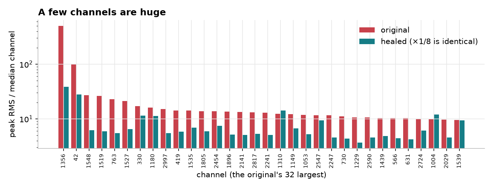
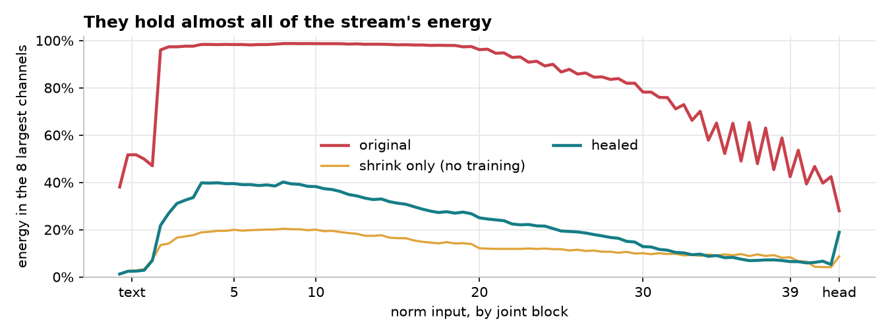
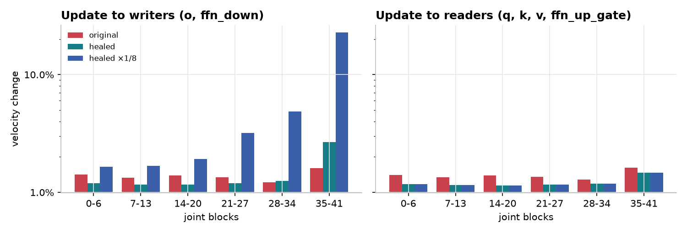

[English](../../concepts/massive-channels.md)

<a id="massive-residual-channels-in-moss-image"></a>
# MOSS-Image 中的巨型残差通道

MOSS-Image 基座 DiT 的残差流能量几乎全部集中在它 3,072 个通道中的少数几个通道里。
本页说明这些通道是什么、为什么移除它们会破坏模型，以及退火式 heal 如何在模型保住
输出的同时移除其中大部分。这些图在基座模型与 heal 后的模型上测得，用的是 512² 的
留出文图样本。

<a id="the-finding-in-one-table"></a>
## 一张表看结论

| | original | healed (heal5k) | healed ×1/8 |
| --- | --- | --- | --- |
| largest channel (1356), peak RMS ÷ median channel | 505× | 39× | 39× |
| energy in the 8 largest channels, block 10 | 98.7 % | 38.2 % | 38.2 % |
| largest value in the stream, block 10 | 38,912 | 2,555 | 319 |
| largest value anywhere in the stream (fp16 max 65,504) | 55,424 | 7,287 | 911 |
| velocity error vs the original, σ 0.5 | 0 | 10.1 % | 10.1 % (same outputs) |
| flow loss on real data vs the original, σ 0.5 | 0 | +2.2 % | +2.2 % |

heal 后的模型是下文 heal 的 step-4,000 快照。


*上：原始。下：heal 后。相同 prompt、seed 与采样器（16 步，CFG 3，1024²）。
动漫、室内与水彩 prompt 都守住了；照片风格的狐狸失去了解剖结构。*

<a id="1-a-few-channels-are-huge"></a>
## 1. 少数通道非常大



在每个 norm 输入处，测量每个通道在所有 token 上的 RMS，再除以中位通道。通道 1356
的峰值是中位通道的 505 倍，通道 42 是 99 倍，另有约 30 个落在 10 倍到 30 倍之间。
从第一个联合块到最后一个联合块，同样的通道在每一块里都很大。



从联合块 1 到块 20，这 8 个通道携带了残差流 96–99 % 的能量，到块 35 仍有约一半。
文本细化器（左）是唯一它们尚未占据主导的部分。


最大值达到 55,424，是 fp16 上限的 85 %。这就是为什么 MOSS-Image 的 fp16 推理与训练
需要 `FP16_FIX` 的残差折叠（[numerics.md](numerics.md)）。

<a id="2-what-the-channels-do"></a>
## 2. 这些通道在做什么

每个块都通过一个 RMSNorm 读取残差流：
`norm(x) = w * x / rms(x)`。当一个通道几乎承载了一个 token 的全部能量时，
`rms(x)` 就由那一个通道决定。巨型通道于是充当**逐 token 音量旋钮**：通过向通道 1356
写入多或少，一个块就设定了该 token 的其他所有通道在下一个块里有多“响”。

这是带 pre-norm 块的残差网络的普遍性质，并非 MOSS 特有：一个从零训练的小型 pre-norm
DiT 在几分钟内就会长出同样的增益通道。在那个小模型里：

- 头部之前的最后一个 norm 并非通道出现所必需；
- 权重衰减会降低它们的尺度，但不会消除它们；
- 对 top-channel 能量占比施加惩罚可以移除它们，代价是任务损失
  （惩罚权重 0.1 代价 +8 % 损失）；
- 把 norm 的分母从梯度中 detach 会让残差流爆炸。

所以这些通道是模型依赖的特性，而不是冗余负担。移除它们就移除了一条模型使用的增益
路径，而这条路径必须被补回来。

<a id="3-shrinking-them-without-training-does-not-work"></a>
## 3. 不训练就想缩小它们行不通

最直接的做法是在每个写入方（embedder、`o`、`ffn_down`）里把每个巨型通道按因子 `D_c`
缩小，并给每个读取方 norm 一个增益来抵消其除数的平均变化。取 `tau 16`（缩小所有超过
中位 16 倍的通道，共 8 个通道）时，残差流的最大值下降 12 倍，能量占比降到 20 %。


它仍然让输出偏移 41 %（中位速度误差；`tau 8` 时 48 %，`tau 4` 时 57 %）。除数的变化
对每个 token 都不同：跨联合块，图像 token 的 5–95 % 区间落在中位变化的 0.50× 到
1.44×，文本 token 落在 0.24× 到 1.90×，即使是最温和的设置也是如此。每个 norm 一个
固定增益无法抵消逐 token 的变化，而每个块又会在上一块之上再叠加一次。

一个精确的替代方案让缩小后残差流的除数与原模型相等：**加权 RMSNorm**，其均方把通道
`c` 按 `1 / D_c²` 加权。它的输出与原模型完全一致，取值也保持在 fp16 范围内。它对模型
的学习方式毫无改变，因为逐 token 的增益路径依然存在，只是计算方式不同。

<a id="4-the-annealed-heal"></a>
## 4. 退火式 heal

heal 从精确模型出发，把它移向普通模型，同时训练让它始终靠近原模型：

1. **精确起点。** 带加权 norm 的缩小模型（tau 16），权重
   `λ_c = (1 / D_c²)^(1 − t)`，在 `t = 0` 时与原模型等价。
2. **退火。** `t` 在前 3,000 步里从 0 升到 1。norm 权重淡出到 1；每个 norm 的增益
   取到与其标定除数比 `r̄` 相匹配的份额：`gain = w / (D · r̄^t)`。
3. **学习其余部分。** 在 `t` 上升期间，训练补回失去的增益路径：
   - 写入方（`o`、`ffn_down`）：全量微调，lr 3e-5；
   - 读取方（`q`、`k`、`v`、`ffn_up_gate`）：LoKr factor 8，lr 5e-4；
   - norm 增益：lr 2e-3；
   - 损失：学生与原始模型速度之间的相对平方误差，
     在相同的加噪输入上（纯蒸馏）。
4. **结束。** 在 `t = 1` 时 norm 又是普通 RMSNorm；结果是一个标准的
   MOSS-Image DiT 文件，凡原模型能加载之处都能加载。

运行：5,000 步、每步 8 个样本、512²，4× RTX 3090，原模型作为 bf16 教师按块流式
加载，学生用 bf16 并开启块检查点。


| step | σ 0.1 | σ 0.3 | σ 0.5 | σ 0.7 | σ 0.9 |
| --- | --- | --- | --- | --- | --- |
| 3,000 (anneal ends) | 23.3 % | 16.3 % | 12.0 % | 10.2 % | 13.0 % |
| 4,000 | 19.2 % | 13.5 % | 10.1 % | 8.8 % | 11.5 % |
| 5,000 | 18.3 % | 13.0 % | 9.8 % | 8.5 % | 11.1 % |

相对原模型的速度误差，32 个留出样本上的中位数。在真实数据上，step-4,000 模型的
flow loss 比原模型高 1.9–3.8 %，取决于 σ。误差在 step 5,000 时仍在下降；heal 尚未收敛。

<a id="what-the-healed-stream-looks-like"></a>
### heal 后的残差流长什么样


在 step 4,000，每块的最大值是 1,300–6,800，而原模型是 18,000–55,000。8 个被缩小的
通道在前 20 个块里回到 20–35 % 的能量（缩小后的目标为 6–11 %）：训练在同样的通道里
长回了部分增益路径。该占比从 step 3,000 起保持平稳。

<a id="5-rescaling-the-whole-stream"></a>
## 5. 缩放整条残差流

heal 之后残差流的 RMS 从 4 到 61。把 embedder 与每个写入方乘以 `c = 1/8`，并把每个
norm eps 乘以 `c²`，会恰好把残差流乘以 1/8，而让每个 norm 的输出——也就是速度——
保持不变（bf16 下差异为 0）。占比与通道比值也不变；只有量级变了：最大值降到 911，
即 fp16 上限的 1.4 %。

这个缩放改变了模型的学习方式。读取方只通过 norm 看残差流，所以它们的梯度不变。
写入方产生残差流：它们的梯度增长 ×8，而权重缩小 ×8。

| weights | gradient | weight size | gradient ÷ weight |
| --- | --- | --- | --- |
| readers (`q`, `k`, `v`, `ffn_up_gate`), norm gains | unchanged | unchanged | unchanged |
| writers (`o`, `ffn_down`), embedders | ×8 | ×1/8 | ×64 |

在 flow-matching 损失上测量（8 个留出样本，σ 0.3 与 0.7，对每个深度带的线性层取
中位数）：


×1/8 副本的梯度在每个读取方上恰好是 heal 后模型的 1.00×，在每个写入方上是 8.00×，
在每个深度带都是如此。heal 本身已经改变了梯度：读取方的梯度是原模型的 0.3–1.0×
（在最前面的块里最小），`o` 的梯度向最后的块增长（块 35–41 里为 2.6×）。

用 Adam 时每一步的绝对幅度大致相同，因此在 8 倍小的写入方上同样的步长就是 8 倍大的
相对变化：



*同样的一个小随机更新施加到某个深度带的写入方（左）或读取方（右）；
柱状图是它导致的速度相对变化。*

在原模型里，一次更新让输出移动 1.2–1.6 %，无论它触及哪个深度带、哪种权重。缩放之后，
同样的更新施加到最后一个深度带的写入方上会让输出移动 23 %。

<a id="the-fp16-fix-is-a-rescale-too"></a>
### fp16 修复也是一种缩放

`FP16_FIX`（[numerics.md](numerics.md)）出于同样的原因缩放残差流，但对训练有两种
不同的影响：

- `FP16_FIX="online"` 在运行时以常量形式施加缩放（门控乘子、写入方输入缩放、eps）。
  存储的权重保持原样，因此没有任何权重的梯度或更新幅度改变：这只是数值修复。
- 写进权重的折叠（fp16-fix 权重文件）会缩放它触及的存储参数。若对 `o` / `ffn_down`
  使用 pre-gate 缩放 `s`，这些写入方的存储值会小 `s` 倍，训练起来就像上面的 ×1/8
  副本。适配器导出会撤销该折叠，所以导出的适配器仍处于原权重空间。

<a id="6-keeping-the-channels-from-coming-back"></a>
## 6. 防止这些通道回来

`CONCENTRATION_LOSS = {"weight": w, "k": k}` 会加上 `w` 乘以（对联合块取平均的）
块输出能量在 `k` 个最大通道中的占比（[training.md](training.md#stream-penalties)；
`STREAM_LOSS` 还对残差流的峰值持有一个软上限）。它为微调期间通道重新长出来标了价。
权重保持小：在小型 pre-norm DiT 中，权重 0.01 让 top-8 占比在 +1.7 % 损失下保持初始
值，而 0.1 的代价是 +8 %。在 heal 后的模型上，权重 0.01、`k = 32` 的 LoKr 微调在
2,700 步里把 top-32 占比保持在 0.21–0.23，起始值为 0.32。

heal 取同样的惩罚，由 `CONC_WEIGHT` / `CONC_K` 控制（见下），作用在学生的块输出上，
与蒸馏损失并列。

<a id="running-the-heal"></a>
## 运行 heal

`kohakumoss.heal` 实现了上面每一步；`scripts/heal/` 下的五个脚本负责运行它们。模型、
内核与显存相关开关都来自训练配置（`TRAIN_CONFIG`），因此教师与学生的构建和放置方式
与一次训练运行完全一致。

| step | script | writes |
| --- | --- | --- |
| 1. records | `cache.py` | per dataset row: planned latents and caption embedding (`part*.pt`), the empty-prompt embedding |
| 2. calibration | `calibrate.py` | report: the 32 largest channels, per tau the shrink scales D, each norm's divisor ratio r̄, the training-free shrink's stream stats and velocity error |
| 3. heal | `heal.py` | `heal.json`, `metrics.jsonl` (per step), `evals.jsonl` (held-out), `grads.json`, `step_<n>/` snapshots, `final/` |
| 4. merge | `merge.py` | one plain single-file DiT from a parts directory at t = 1 |
| 5. rescale | `rescale.py` | the ×c copy (c the power of two nearest 1 / the stream RMS) and its exactness report |

```bash
kogine run scripts/heal/cache.py --set TRAIN_CONFIG=my_run.py --set OUT=heal/records \
    --set ROWS=17000 --set PART=0 --set PARTS=4          # one process per GPU, PART 0..3
kogine run scripts/heal/calibrate.py --set DIT=moss_image_base_bf16.safetensors \
    --set RECORDS=heal/records --set OUT=heal/calibration.json
kogine run scripts/heal/heal.py --config configs/heal/recipes/recipes_anneal_5k_4x24g.py \
    --set TRAIN_CONFIG=my_run.py --set TEACHER=moss_image_base_bf16.safetensors \
    --set REPORT=heal/calibration.json --set RECORDS=heal/records --set OUT=heal/runs/heal5k
kogine run scripts/heal/merge.py --set RUN=heal/runs/heal5k --set OUT=healed.safetensors
kogine run scripts/heal/rescale.py --set DIT=healed.safetensors --set RECORDS=heal/records \
    --set OUT=healed_x8.safetensors
```

这次运行是怎么搭起来的：

- **Student。** `STUDENT`（为空时用教师的文件），加载时附带 LoKr 适配器和
  `TRAIN_NORMS` 增益增量。设置 `REPORT` 时，写入方就地在位按 D 缩放，norm 增益按
  1 / D 缩放，学生的 norm 通过其 `OpSet` 绑定到加权 RMSNorm 算子
  （`kohakumoss.heal.wnorm`）；模型里没有任何东西被 patch。
- **Anneal。** 每一步设置 `t = min(1, step / ANNEAL_STEPS)`：norm 通道权重
  变成 (1 / D²)^(1 − t)，每个增益变成 g0 · r̄^−t（`ANNEAL_RBAR`；否则 r̄ = 1）。
  `ANNEAL_STEPS = 0` 从 t = 1 开始；没有 `REPORT` 时，学生从其文件原样开始
  （从 heal 后模型出发的第二阶段 heal）。
- **Trainables。** `MODE="full_writers"`：`o` / `ffn_down` 全量（AdamW16、随机舍入、
  `LR_FULL`），在 `q` / `k` / `v` / `ffn_up_gate` 上用 LoKr factor `LOKR_FACTOR`
  （AdamW、`LR_LOKR`）；`MODE="lokr"`：只在 `LOKR_TARGET` 上用 LoKr。norm 增益增量
  始终训练（AdamW、`LR_NORM`）。先 warmup，再余弦到 1 %。
- **Loss。** 学生与教师在同一批加噪记录上的速度之间的相对平方误差，加上 `HARD_WEIGHT`
  × 相对 flow 目标的相对误差，加上 `CONC_WEIGHT` × 学生块输出的 top-`CONC_K` 通道占比。
- **Placement。** `TEACHER_MEMORY` / `STUDENT_MEMORY` 是叠加在训练配置之上的显存开关
  （该 recipe：教师通过双槽块环流式加载，学生常驻并开启块检查点）。按 `DEVICES` 生成
  rank，每一步 all-reduce 它们的梯度。
- **Evaluation。** 每 `EVAL_EVERY` 步，在 `HELD` 留出记录上、σ 0.1 … 0.9 且固定噪声：
  相对教师的速度误差、两个 flow loss、学生与 D 缩放教师的逐块残差流统计、增益与
  写入方漂移。梯度图（`GRAD_MAP`）在第一步之前与最后一步之后各取一次。
- **Merge。** 学生文件在 t = 1 重建缩小（写入方 × D，增益 w / (D r̄)），再合并训练过的
  写入方，然后合并 LyCORIS 文件：一个标准 DiT 文件。

<a id="open-points"></a>
## 待解决的点

- heal 尚未收敛：误差在 step 5,000 时仍在下降。
- 被缩小的通道在 heal 期间重新长到能量的 20–35 %；下一次运行是在教师损失旁边加上
  集中度惩罚和真实数据损失的 heal。
- heal 是在 512² 上跑的；1024² 的照片类 prompt 损失最大。
